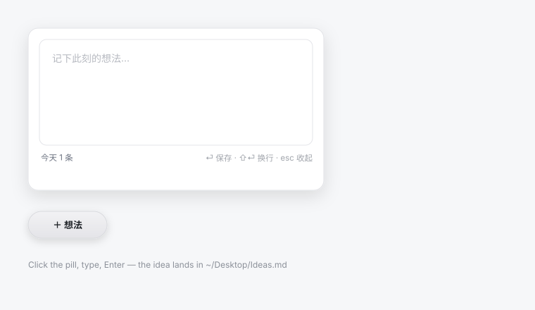

# Idea Box

**A tiny always-on-top window for the idea you don't want to lose.**

Click the frosted `＋ 想法` pill, type one line, press <kbd>Enter</kbd>. The idea is
appended to a plain Markdown file on your Desktop, grouped by month. No account,
no sync, no database, no Electron — a single ~120 KB native AppKit binary.



---

## Why

Every capture tool asks you to leave what you are doing: open a notes app, pick a
notebook, wait for it to load. Idea Box is the opposite — it sits in the corner of
the screen, above everything, and gets out of the way in one second:

1. Click the pill (it floats over every window, on every Space, over full-screen apps)
2. Type
3. <kbd>Enter</kbd> — the box folds itself back into the pill

Your notes stay files you own: `~/Desktop/Ideas.md`, readable by any editor, any
script, and any agent that can read Markdown.

## Features

- **One gesture to capture** — click, type, Enter. The window is back to a pill a
  second after the save.
- **Always on top, always there** — `NSWindow.Level.floating`, joined to every
  Space and visible over full-screen apps.
- **Plain Markdown, one file** — `~/Desktop/Ideas.md`, one `## Month Year` section
  per month, one `- DD HH:MM` line per idea.
- **Native and dependency-free** — AppKit only, no Electron, no web view, no
  network access, no telemetry.
- **Light and dark** — the pill follows the system appearance; the editor is a
  solid surface that adapts with it.
- **Launch at login** — optional per-user LaunchAgent, one command.

## Install

### Option 1 — prebuilt app (recommended)

1. Download `IdeaBox-vX.Y.Z.zip` from [Releases](../../releases).
2. Unzip it and move **Idea Box.app** to `~/Applications`.
3. First launch: **right-click the app → Open** (the build is ad-hoc signed, not
   notarised, so Gatekeeper asks once).

### Option 2 — build from source

Requires macOS 12+ and the Xcode Command Line Tools (`xcode-select --install`).

```sh
git clone https://github.com/nickhuang500-web/idea-box.git
cd idea-box
make install      # builds build/Idea Box.app and copies it to ~/Applications
make run          # …and opens it
```

## Usage

| Action | Key |
| --- | --- |
| Open the box | click the `＋ 想法` pill |
| Save the idea | <kbd>Enter</kbd> |
| New line inside one idea | <kbd>Shift</kbd>+<kbd>Enter</kbd> |
| Fold the box back into the pill | <kbd>Esc</kbd> or click outside |
| Quit | <kbd>⌘</kbd>+<kbd>Q</kbd> |

## Where your ideas live

Everything goes into a single file on the Desktop:

```markdown
# Ideas

## November 2026
- 09 21:16 improve the vibe coding app
- 09 21:40 a second thought, same day
- 12 08:02 new day, same month — still one heading

## December 2026
- 01 10:31 a new month gets its own heading
```

- One `## Month Year` heading per month — never one per day.
- Each line starts with `- DD HH:MM`, followed by the text. Continuation lines of
  a multi-line idea are indented by two spaces.
- The app creates the file (and the folder) on first save.
- Set `IDEA_BOX_FILE=/path/to/notes.md` in the environment to point it somewhere
  else (handy for tests).

## Launch at login

```sh
make autostart     # installs ~/Library/LaunchAgents/…plist and loads it now
make no-autostart  # removes it
```

## Customise

Everything worth changing is in `Sources/main.swift`:

| What | Where |
| --- | --- |
| All UI text (translate to your language) | `enum L` at the top of the file |
| Pill size, editor size, screen margin | `pillSize`, `editorSize`, `margin` in `AppDelegate` |
| Auto-fold delay after a save | `collapseTimer` in `save()` |
| File location | `IdeaStore.fileURL` (or `IDEA_BOX_FILE`) |

Then rebuild with `make install`.

## Project layout

```
.
├── Sources/main.swift          # the whole app (~470 lines)
├── Resources/Info.plist        # bundle identity
├── scripts/build.sh            # swiftc → build/Idea Box.app, --install to ~/Applications
├── scripts/autostart.sh        # optional LaunchAgent
├── Makefile                    # make / make install / make run / make autostart
├── docs/                       # screenshots used by this README
└── .github/workflows/          # CI build + tag-driven release
```

## Development

```sh
make                 # build only → build/Idea Box.app
make install         # build + install to ~/Applications
./scripts/build.sh   # same, without make
```

There is also a headless self-test that exercises the storage layer without
opening a window:

```sh
IDEA_BOX_FILE=/tmp/Ideas.md ./build/"Idea Box.app"/Contents/MacOS/IdeaBox --selftest "hello"
```

Every push builds the app on GitHub Actions; every `v*` tag builds it, zips it,
and attaches the zip to the release.

## Troubleshooting

| Symptom | Fix |
| --- | --- |
| `swiftc not found` | `xcode-select --install` |
| macOS says the app is from an unidentified developer | right-click → **Open** once, or `xattr -dr com.apple.quarantine "$HOME/Applications/Idea Box.app"` |
| The pill is not visible | check it was not dragged off-screen: quit and relaunch; it repositions bottom-right |
| Nothing is saved | check the file exists and is writable: `ls -l ~/Desktop/Ideas.md` |

## 中文说明

一个常驻桌面右下角的小工具：点一下毛玻璃药丸「＋ 想法」，写一句，回车即存。

- 记录写进桌面的 **`Ideas.md`**，按月份分节（`## November 2026`），每条带「日 时间」
- 窗口常驻置顶、跨桌面可见；保存后 1 秒自动收回成药丸
- 纯原生 AppKit 实现，约 120 KB，无 Electron、无网络、无依赖
- 编译：`make install`；开机自启：`make autostart`

## License

MIT © 2026 nickhuang500-web
